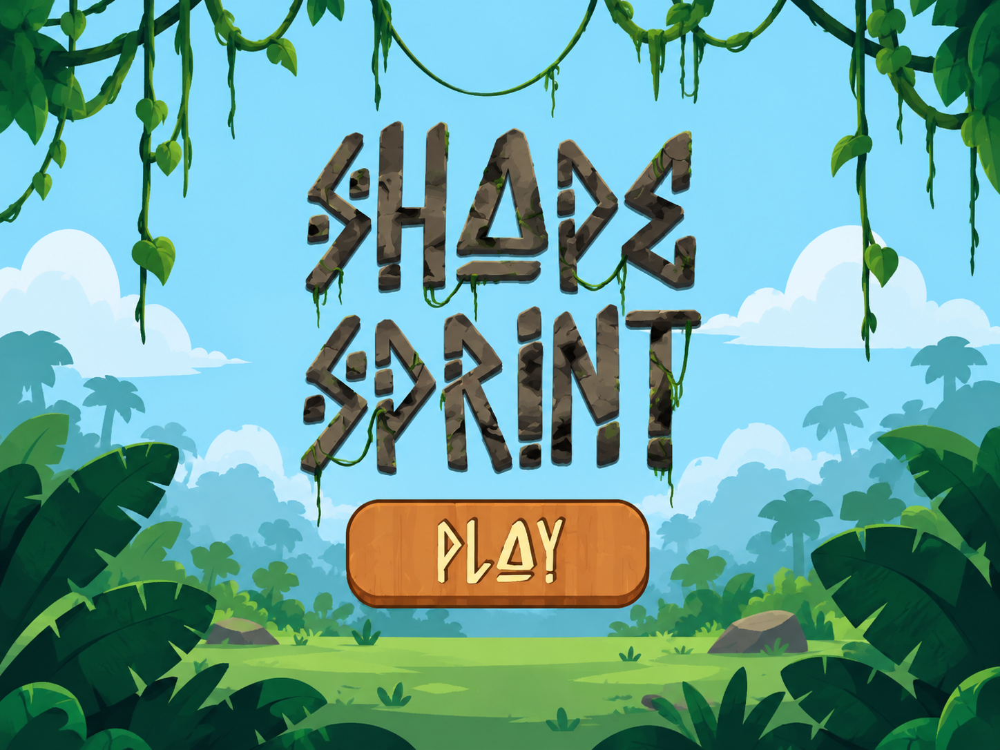
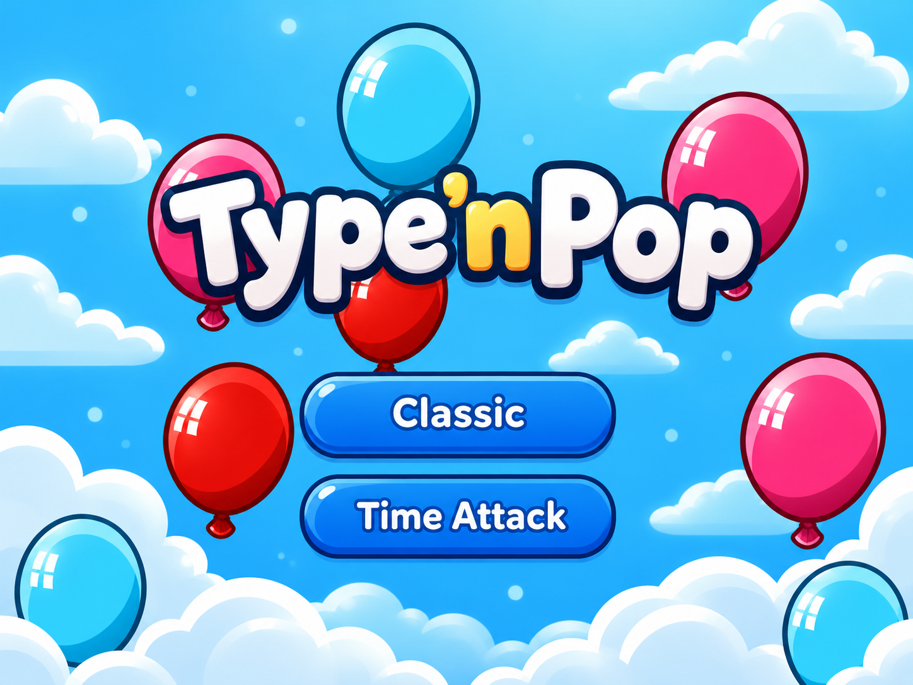

# Hey, I'm Hanana! 👋
### 🎮 Unity Game Developer · Gameplay Programmer · Creative Problem Solver

*I turn ideas into playable experiences — from satisfying puzzle mechanics to colorful arcade games.*

---

## 🕹️ Featured games

<table>
<tr>
<td width="34%" align="center" valign="middle"></td>
<td valign="middle">

### 🌿 [Shape Sprint](https://github.com/hananaasif/shape_sprint)
**3D Runner · Unity · C#**

An arcade runner with **six levels**, cube-to-sphere transformations, three-lane movement, obstacle avoidance, and coin collection. I programmed the gameplay and systems, including input, camera tracking, health and progression; UI art was provided by an artist.

**[▶ Watch gameplay](https://youtu.be/TKDkQiinLcs)** · **[💻 View source](https://github.com/hananaasif/shape_sprint)**

</td>
</tr>
<tr>
<td width="34%" align="center" valign="middle"></td>
<td valign="middle">

### 🎈 [Type 'n Pop](https://github.com/hananaasif/TypenPopGame)
**2D Typing Arcade · Unity · C# · TextMeshPro**

Type words to pop rising balloons in **60-second timed** or **five-life survival** mode. Features randomized spawns, increasing challenge, physics, animations, audio, and light/dark themes.

**[🎮 Play on itch.io](https://hananaasif.itch.io/type-n-pop)** · **[💻 View source](https://github.com/hananaasif/TypenPopGame)**

</td>
</tr>
</table>

## ✨ More things I've built

- 🧩 **HexaMerge** — A Unity puzzle prototype inspired by *HexaBlock Puzzle Merge*, featuring drag-and-drop tile placement and a three-tile merge system.
- 🏡 **Virtual Agent for Real Estate** — Contributed to a team-built Unreal Engine 5 property-tour experience with MetaHuman, Blueprints, NVIDIA Audio2Face and Live Link.
- 🛠️ **Unity Editor Level Generator** — Built an Editor window that automatically generates levels from configurable parameters.

## 💼 Professional experience

- **Associate Game Developer · Mindstorm Studios** *(Jul–Oct 2026)* — Contributed to commercial Unity titles, including puzzle gameplay mechanics, mobile SDK/Billing updates and build issue resolution; submitted AABs for QA.
- **Unity Developer · Algoryte** *(Mar–May 2026)* — Contributed to *Exofarm*'s idle mode and started migrating interface panels from UGUI to UI Toolkit.
- **Unity Development Intern · Algoryte** *(Jul–Oct 2025)* — Helped build *Bladder Defender*, a 2D educational platformer, including enemies, interactions, hazards, quizzes and level assembly.
- **Unity Development Intern · Mindstorm Studios** *(Jun–Aug 2024)* — Programmed *Shape Sprint* for Rookie Game Jam 2024.

## 🧰 My toolbox

**Game development:** `Unity 2D/3D` · `C#` · `Gameplay Systems` · `Unity Input System` · `Cinemachine` · `Animator` · `UGUI` · `UI Toolkit` · `Custom Editor Tools`

**3D & interactive:** `Unreal Engine 5` · `Blueprints` · `MetaHuman` · `NVIDIA Audio2Face` · `Live Link` · `Blender`

**Workflow:** `Git/GitHub` · `Android AAB` · `Google Play Billing` · `Debugging` · `Level Design/Implementation` · `Game Design Documents`

## 🌱 What I enjoy

Creating intuitive controls, polished game feel, interesting puzzles, and tools that make game development faster. I'm especially interested in **gameplay programming, mobile games, and interactive 3D experiences**.

---

### 🎯 Thanks for stopping by!

**[🎈 Play Type 'n Pop](https://hananaasif.itch.io/type-n-pop)** · **[🌿 Watch Shape Sprint](https://youtu.be/TKDkQiinLcs)** · **[🤝 Connect on LinkedIn](https://www.linkedin.com/in/hanana-asif)**

