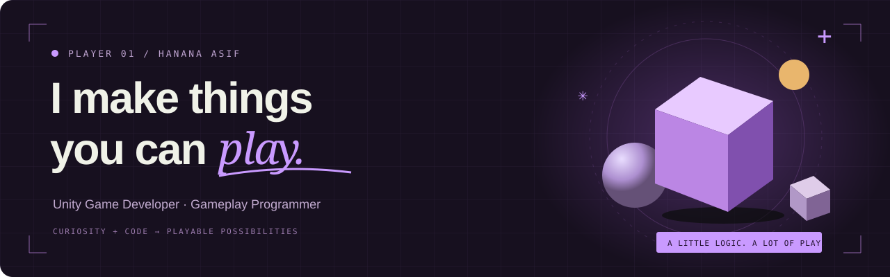

  

### Hey, I’m Hanana. Welcome to my playground.

I build **satisfying mechanics, colorful worlds, and games that feel good to play.**  
Unity developer with a love for gameplay systems, mobile games, and creative problem solving.

  
  

[LinkedIn ↗](https://www.linkedin.com/in/hanana-asif) &nbsp; / &nbsp; [itch.io ↗](https://hananaasif.itch.io/type-n-pop) &nbsp; / &nbsp; [Say hello ↗](mailto:hananaasif2004@gmail.com)

 

## 01 / Select your game

<table>
<tr>
<td width="42%" align="center" valign="middle"></td>
<td width="58%" valign="middle"><h3>🛗 Elevator</h3>
<code>PUZZLE</code> <code>LEVEL DESIGN</code> <code>5 LEVELS</code>

<b>A new layer of play.</b> Clear the blocks above to open the elevator and bring new blocks to the surface. Keep it covered until the right moment.

<b>My work:</b> five level designs built around the elevator mechanic, covering levels 1056–1060.

<a href="https://hananaasif.github.io/#elevator"><b>Explore the mechanic & levels ↗</b></a>
</td>
</tr>
<tr>
<td width="42%" align="center" valign="middle"></td>
<td width="58%" valign="middle"><h3>💧 Bladder Defender</h3>
<code>2D PLATFORMER</code> <code>UNITY</code> <code>3 LEVELS</code>

<b>Play, explore, and learn.</b> A colorful educational platformer with three levels that combines playful challenges with learning about bladder hygiene and healthy habits.

<b>My contribution:</b> enemies, hazards, interactions, quizzes, and level assembly during my Algoryte internship.

<a href="https://www.youtube.com/watch?v=dA0SvbnZw4g"><b>▶ Watch gameplay</b></a>
</td>
</tr>
<tr>
<td width="42%" align="center" valign="middle">

</td>
<td width="58%" valign="middle">
<h3>🎈 Type ’n Pop</h3>

<code>2D TYPING ARCADE</code> <code>UNITY</code> <code>C#</code>

<b>Quick fingers. Happy little explosions.</b> Type to pop rising balloons in a 60-second sprint or a five-life survival challenge.

<b>The details:</b> randomized spawns, increasing difficulty, physics, animations, audio, TextMeshPro, and light/dark themes.

<a href="https://hananaasif.itch.io/type-n-pop"><b>▶ Play on itch.io</b></a> &nbsp; · &nbsp; <a href="https://github.com/hananaasif/TypenPopGame">Source ↗</a>

</td>
</tr>
<tr>
<td width="42%" align="center" valign="middle">

</td>
<td width="58%" valign="middle">
<h3>🌿 Shape Sprint</h3>

<code>3D RUNNER</code> <code>UNITY</code> <code>C#</code>

<b>Shift your shape. Find your rhythm.</b> Six levels of cube-to-sphere transformations, three-lane movement, obstacle dodging, and coin collection.

<b>My contribution:</b> gameplay programming, input, camera tracking, health, and progression. UI artwork by a collaborating artist.

<a href="https://youtu.be/TKDkQiinLcs"><b>▶ Watch gameplay</b></a> &nbsp; · &nbsp; <a href="https://github.com/hananaasif/shape_sprint">Source ↗</a>

</td>
</tr>
</table>

 

## 02 / Side quests

### 🧩 HexaMerge
Unity puzzle prototype inspired by *HexaBlock Puzzle Merge*, featuring drag-and-drop tile placement and a three-tile merge system.  
UNITY · C# · PUZZLE MECHANICS

### 🏡 Virtual Agent for Real Estate
Contributed to a team-built UE5 property-tour experience with MetaHuman, Blueprints, NVIDIA Audio2Face, and Live Link.  
UNREAL ENGINE 5 · INTERACTIVE 3D

### 🛠 Unity Editor Level Generator
Custom Editor window that automatically generates levels from configurable parameters.  
UNITY EDITOR · CUSTOM TOOLS

 

## 03 / Experience points

**Mindstorm Studios** · Associate Game Developer  
JUL — OCT 2026  
Commercial Unity titles: puzzle gameplay mechanics, mobile SDK/Billing updates, build issue resolution, and AAB submissions for QA.

**Algoryte** · Unity Developer  
MAR — MAY 2026  
Contributed to *Exofarm*’s idle mode and began migrating interface panels from UGUI to UI Toolkit.

<b>Earlier chapters — internships</b>

 

**Algoryte** · Unity Development Intern  
JUL — OCT 2025  
Helped build *Bladder Defender*, a 2D educational platformer: enemies, interactions, hazards, quizzes, and level assembly.

**Mindstorm Studios** · Unity Development Intern  
JUN — AUG 2024  
Programmed *Shape Sprint* for Rookie Game Jam 2024.

 

## 04 / My loadout

**Gameplay**  
`Unity 2D/3D` `C#` `Gameplay Systems` `Input System` `Cinemachine` `Animator`

**UI & tools**  
`UGUI` `UI Toolkit` `TextMeshPro` `Custom Editor Tools`

**Interactive 3D**  
`Unreal Engine 5` `Blueprints` `MetaHuman` `Audio2Face` `Live Link` `Blender`

**Shipping & workflow**  
`Git/GitHub` `Android AAB` `Google Play Billing` `Debugging` `Level Implementation` `Game Design Documents`

 

---

### A little logic. A lot of play.

I enjoy intuitive controls, polished game feel, interesting puzzles,  
and tools that make creating games a little easier.

**Have something playable in mind? [Let’s talk ↗](mailto:hananaasif2004@gmail.com)**

[Explore my portfolio](https://hananaasif.github.io/) &nbsp; · &nbsp; [Play Type ’n Pop](https://hananaasif.itch.io/type-n-pop) &nbsp; · &nbsp; [Connect on LinkedIn](https://www.linkedin.com/in/hanana-asif)

